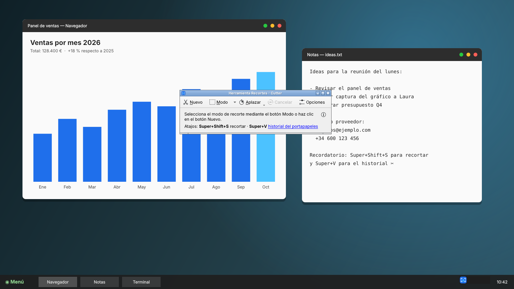
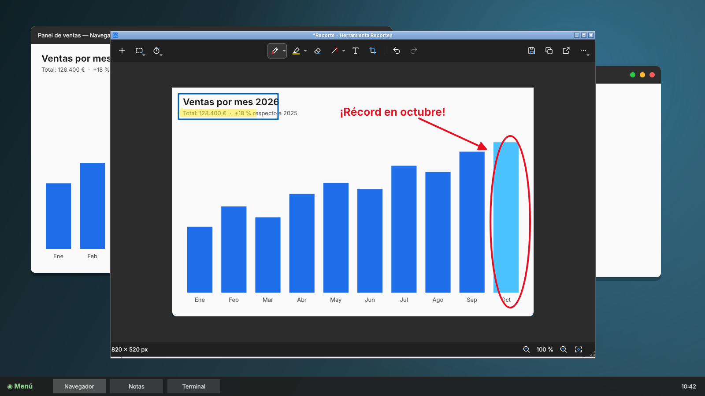
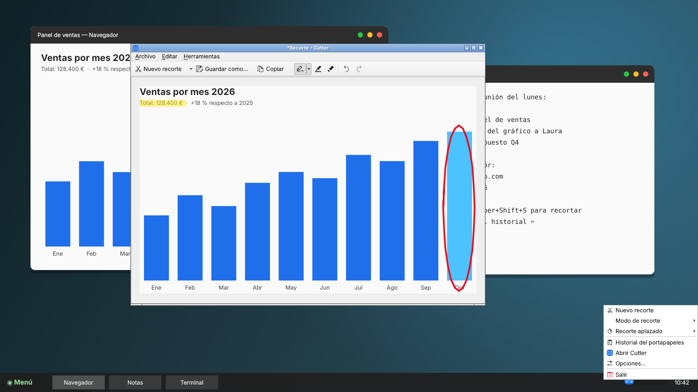
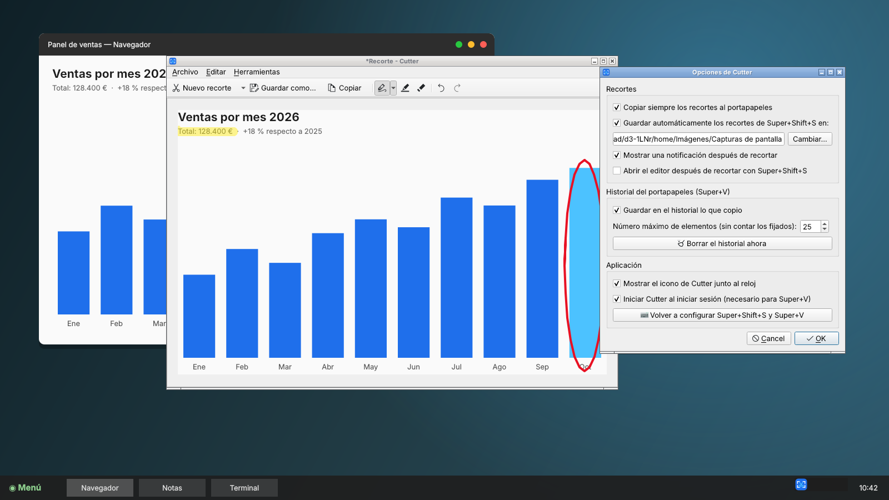

<div align="center">


# Cutter para Linux y macOS

**La Herramienta Recortes y el historial del portapapeles de Windows, para Linux y Mac.**

Pulsa <kbd>Super</kbd>+<kbd>Shift</kbd>+<kbd>S</kbd> para recortar cualquier parte de la pantalla
y <kbd>Super</kbd>+<kbd>V</kbd> para ver todo lo que has copiado. También puedes abrir la ventana
clásica desde el menú o desde el icono junto al reloj.

Paquetes para **Debian/Ubuntu/Mint**, **Arch/CachyOS**, **Fedora** y **macOS** (Apple Silicon e Intel),
más un instalador sin root para sistemas inmutables (**Bazzite**, Silverblue, SteamOS).<br />
En Mac los atajos son <kbd>Ctrl</kbd>+<kbd>Shift</kbd>+<kbd>S</kbd> y <kbd>Ctrl</kbd>+<kbd>Shift</kbd>+<kbd>V</kbd>.<br />
Funciona en KDE Plasma, GNOME, Cinnamon, XFCE y Hyprland, en X11 y Wayland.

</div>


## ¿Qué es Cutter?

Si vienes de Windows, seguro que usas a diario la Herramienta Recortes y el historial
del portapapeles. Cutter lleva esa misma experiencia a Linux y a Mac, con los mismos
atajos y el mismo comportamiento.

| Cómo | Qué hace |
|---|---|
| **Super + Shift + S** (Mac: **Ctrl + Shift + S**) | Congela la pantalla y te deja elegir qué recortar. El recorte se copia al portapapeles y se guarda en `Imágenes/Capturas de pantalla`. |
| **Super + V** (Mac: **Ctrl + Shift + V**) | Abre el historial del portapapeles con todo lo que copiaste, tanto textos como imágenes. Al elegir un elemento se pega en la app que estabas usando. |
| **Icono de Cutter** (menú, barra de tareas, junto al reloj o barra de menús del Mac) | Abre la ventana clásica con **Nuevo · Modo · Aplazar · Cancelar · Opciones**. El recorte se abre en un editor para anotarlo. |

<table>
<tr>
<td width="50%"></td>
<td width="50%"></td>
</tr>
<tr>
<td align="center"><b>Ventana clásica</b>: Nuevo, Modo, Aplazar, Cancelar, Opciones</td>
<td align="center"><b>Editor</b>: pluma, resaltador, borrador, copiar y guardar</td>
</tr>
<tr>
<td width="50%"></td>
<td width="50%"></td>
</tr>
<tr>
<td align="center"><b>Super+V</b>: historial con textos e imágenes</td>
<td align="center"><b>Icono junto al reloj</b> con todas las opciones</td>
</tr>
<tr>
<td width="50%"></td>
<td width="50%"></td>
</tr>
<tr>
<td align="center">Recorte de <b>forma libre</b></td>
<td align="center"><b>Opciones</b></td>
</tr>
</table>

## Instalación

Los instaladores están en la carpeta [`instalador/`](instalador/).

> **¿Ya tenías Cutter instalado?** Sigue los pasos de
> [Actualizar desde una versión anterior](#actualizar-desde-una-versión-anterior).

### Debian, Ubuntu, Linux Mint, Pop!_OS, Zorin OS

```bash
wget https://github.com/anrennnn/Cutter-Linux/raw/main/instalador/cutter-linux_0.4.0_all.deb
sudo apt install ./cutter-linux_0.4.0_all.deb
```

Para desinstalarlo: `sudo apt remove cutter-linux`.

### Arch Linux, CachyOS, EndeavourOS, Manjaro

```bash
wget https://github.com/anrennnn/Cutter-Linux/raw/main/instalador/cutter-linux-0.4.0-1-any.pkg.tar.zst
sudo pacman -U cutter-linux-0.4.0-1-any.pkg.tar.zst
```

También puedes compilarlo tú, como los paquetes del AUR:
`git clone https://github.com/anrennnn/Cutter-Linux.git && cd Cutter-Linux/packaging/arch && makepkg -si`.

Para desinstalarlo: `sudo pacman -R cutter-linux`.

### Fedora (Workstation, KDE Plasma y los spins Cinnamon, XFCE…)

```bash
sudo dnf install https://github.com/anrennnn/Cutter-Linux/raw/main/instalador/cutter-linux-0.4.0-1.noarch.rpm
```

`dnf` instala también PyQt6 y lo demás que haga falta. En **Fedora Workstation (GNOME)**,
el icono junto al reloj necesita la extensión AppIndicator. El paquete la instala
(`gnome-shell-extension-appindicator`), pero tienes que activarla una vez en la app
*Extensiones* o cerrando sesión.

Para desinstalarlo: `sudo dnf remove cutter-linux`.

### Bazzite, Fedora Silverblue / Kinoite y otros sistemas inmutables

En estos sistemas `/usr` es de solo lectura, así que hay dos caminos:

**Opción A: instalación por usuario (recomendada, sin root y sin reiniciar).**
Usa el PyQt6 del sistema si existe; si no, lo descarga en `~/.local/share/cutter-linux`.

```bash
curl -L https://github.com/anrennnn/Cutter-Linux/archive/refs/heads/main.tar.gz | tar xz
cd Cutter-Linux-main
./instalar-usuario.sh
```

Para actualizar, repite los mismos pasos. Para quitarlo: `./instalar-usuario.sh --desinstalar`.

**Opción B: añadir el paquete al sistema con `rpm-ostree` (queda integrado, pero hay que reiniciar).**

```bash
curl -LO https://github.com/anrennnn/Cutter-Linux/raw/main/instalador/cutter-linux-0.4.0-1.noarch.rpm
rpm-ostree install ./cutter-linux-0.4.0-1.noarch.rpm
systemctl reboot
```

Si eliges la opción A en Bazzite y el instalador dice que falta `xcb-util-cursor` o
`wl-clipboard`, añádelos con `rpm-ostree install xcb-util-cursor wl-clipboard` y reinicia.

### macOS (Apple Silicon e Intel)

1. Descarga el `.dmg` de tu Mac:
   - **Apple Silicon (M1–M4):** [Cutter-0.4.0-macOS-AppleSilicon.dmg](https://github.com/anrennnn/Cutter-Linux/releases/latest/download/Cutter-0.4.0-macOS-AppleSilicon.dmg)
   - **Intel:** [Cutter-0.4.0-macOS-Intel.dmg](https://github.com/anrennnn/Cutter-Linux/releases/latest/download/Cutter-0.4.0-macOS-Intel.dmg)

   ¿No sabes cuál es el tuyo? Ve a menú  → *Acerca de este Mac*. Si pone «Chip Apple M…»,
   es Apple Silicon; si pone «Procesador Intel…», es Intel.
2. Abre el `.dmg` y arrastra **Cutter** a **Aplicaciones**.
3. Abre Cutter. Como no está firmado con una cuenta de Apple Developer, macOS lo
   bloqueará la primera vez:
   - Ve a *Ajustes del Sistema → Privacidad y seguridad*.
   - Abajo verás «Se ha bloqueado "Cutter"». Pulsa **Abrir igualmente**.
   - También puedes desbloquearlo desde la Terminal:
     `xattr -dr com.apple.quarantine /Applications/Cutter.app`
4. Concede los permisos que pide macOS:
   - **Grabación de pantalla**, para recortar. Después de activarlo, sal de Cutter
     (icono de tijeras de la barra de menús → *Salir*) y vuelve a abrirlo.
   - **Accesibilidad**, solo para que el historial pegue automáticamente. Sin este
     permiso, lo que elijas en el historial queda copiado y lo pegas tú con Cmd+V.

En Mac los atajos son **Ctrl+Shift+S** (recortar) y **Ctrl+Shift+V** (historial), porque
Cmd+Shift+S es «Guardar como» y Cmd+V es pegar. Cutter vive en la barra de menús, junto
al reloj, y solo aparece en el Dock mientras tiene una ventana abierta. Para que arranque
al iniciar sesión, activa la opción correspondiente en *Opciones*.

Para desinstalarlo: sal de Cutter, arrastra *Cutter* de Aplicaciones a la Papelera y,
si quieres, borra `~/Library/Application Support/Cutter` y
`~/Library/LaunchAgents/app.cutter.Cutter.plist`.

### Después de instalar (Linux)

Abre **Cutter** desde el menú de aplicaciones. Aparecerá la ventana clásica y, junto
al reloj, el icono de Cutter. La primera vez, Cutter configura Super+Shift+S y Super+V
en tu escritorio.

- **Anclar a la barra de tareas:** con la ventana abierta, haz clic derecho en su icono
  de la barra y elige *Anclar* (o *Añadir a favoritos* en GNOME).
- **KDE Plasma** (el escritorio por defecto de CachyOS, Fedora KDE y Bazzite): Spectacle
  y Klipper ya usan esos atajos. Cutter le deja a Spectacle la tecla
  <kbd>Imprimir</kbd> y desactiva el Meta+V de Klipper.
- **GNOME:** Super+V abría las notificaciones; ahora se abren con Super+M.
- **Hyprland, Sway o niri:** Cutter no toca tu archivo de configuración, pero te dice
  qué líneas añadir.

## Actualizar desde una versión anterior

No hace falta desinstalar nada: instala el paquete nuevo encima del anterior. Tu historial
del portapapeles y tus ajustes se conservan. Abre una terminal y copia los comandos de tu
sistema.

### Debian, Ubuntu, Linux Mint, Pop!_OS, Zorin OS

```bash
cutter-linux salir
wget https://github.com/anrennnn/Cutter-Linux/raw/main/instalador/cutter-linux_0.4.0_all.deb
sudo apt install ./cutter-linux_0.4.0_all.deb
cutter-linux atajos
cutter-linux
```

### Arch Linux, CachyOS, EndeavourOS, Manjaro

```bash
cutter-linux salir
wget https://github.com/anrennnn/Cutter-Linux/raw/main/instalador/cutter-linux-0.4.0-1-any.pkg.tar.zst
sudo pacman -U cutter-linux-0.4.0-1-any.pkg.tar.zst
cutter-linux atajos
cutter-linux
```

### Fedora

```bash
cutter-linux salir
sudo dnf install https://github.com/anrennnn/Cutter-Linux/raw/main/instalador/cutter-linux-0.4.0-1.noarch.rpm
cutter-linux atajos
cutter-linux
```

### Bazzite, Silverblue y otros sistemas inmutables

Con la instalación por usuario, repite los mismos pasos de instalación. El script
detecta que Cutter ya está instalado y lo actualiza:

```bash
curl -L https://github.com/anrennnn/Cutter-Linux/archive/refs/heads/main.tar.gz | tar xz
cd Cutter-Linux-main
./instalar-usuario.sh
cutter-linux atajos
```

Si lo instalaste con `rpm-ostree`, descarga el `.rpm` nuevo, ejecuta
`rpm-ostree uninstall cutter-linux` y después `rpm-ostree install ./cutter-linux-<versión>.noarch.rpm`.
Para terminar, reinicia.

### macOS

1. Sal de Cutter: icono de tijeras de la barra de menús → *Salir*.
2. Descarga el `.dmg` nuevo (enlaces en la sección de instalación de macOS) y arrastra
   **Cutter** a **Aplicaciones**. Cuando te pregunte, elige **Reemplazar**.
3. Vuelve a abrir Cutter. Si macOS vuelve a bloquearlo o a pedir permisos, repite los
   pasos 3 y 4 de la instalación: cada versión sin firmar cuenta como una app nueva.

### Qué hace cada comando

| Comando | Para qué sirve |
|---|---|
| `cutter-linux salir` | Cierra la versión anterior, que sigue abierta en segundo plano. Si no la cierras, seguirá funcionando la vieja hasta que reinicies. |
| `apt` / `pacman` / `dnf` | Instala la versión nueva y descarga solas las dependencias nuevas, como el complemento de iconos SVG. |
| `cutter-linux atajos` | Vuelve a registrar Super+Shift+S y Super+V. **En KDE Plasma es obligatorio al pasar a la 0.3**, porque cambió la forma de registrarlos. En los demás escritorios no hace daño. |
| `cutter-linux` | Abre la ventana nueva y pone el icono junto al reloj. |

### Comprobar que se actualizó

- `cutter-linux version` debe mostrar `Cutter 0.4.0`.
- Al abrir **Cutter** desde el menú tiene que aparecer la ventana con
  **Nuevo · Modo · Aplazar · Cancelar · Opciones**.

### Si algo no funciona

- **KDE:** si Super+Shift+S sigue abriendo Spectacle, cierra sesión y vuelve a entrar.
- **GNOME (Pop!_OS, Zorin, Fedora Workstation):** si no ves el icono junto al reloj,
  activa la extensión **AppIndicator** en la app *Extensiones*.
- **Si `cutter-linux` no se encuentra** tras la instalación por usuario, usa la ruta
  completa: `~/.local/bin/cutter-linux`.
- ¿Sigue fallando? Abre un aviso en
  [Issues](https://github.com/anrennnn/Cutter-Linux/issues) indicando tu distribución,
  tu escritorio y lo que ves.

## Funciones

**Ventana clásica (clic en el icono de Cutter)**
- **Nuevo** hace un recorte con el modo elegido. **Modo ▾** permite elegir entre forma
  libre, rectangular, ventana y pantalla completa.
- **Aplazar ▾** espera entre 1 y 5 segundos antes de recortar, para que te dé tiempo a
  abrir menús. **Cancelar** detiene la cuenta atrás.
- **Opciones** abre la ventana de ajustes.
- Usa los colores, la fuente y los iconos de tu escritorio.

**Editor (se abre tras recortar desde la ventana)**
- Pluma en rojo, azul, negro, verde o el color que elijas, con punta fina, media o gruesa.
- Resaltador amarillo.
- Borrador que quita trazos completos, como en Windows.
- Deshacer (Ctrl+Z) y rehacer (Ctrl+Y).
- Copiar (Ctrl+C), Guardar como PNG/JPEG/BMP (Ctrl+S) y Nuevo recorte (Ctrl+N).
- Si cierras con cambios sin guardar, te pregunta antes.

**Recorte rápido (Super+Shift+S)**
- Cuatro modos: rectangular, ventana, pantalla completa y forma libre, con la barra de
  modos arriba en el centro. Para cancelar, pulsa Esc, el botón ✕ o el clic derecho.
- Funciona con varios monitores.
- El recorte se copia al portapapeles, se guarda como PNG y aparece una notificación.
  Al hacer clic en ella, el recorte se abre en el editor.

**Portapapeles (Super+V)**
- Guarda textos e imágenes, 25 elementos por defecto (configurable). Los fijados no
  cuentan para el límite y se mantienen aunque reinicies.
- En el menú `•••` de cada elemento: Fijar/Desanclar, Eliminar y Borrar todo.
- Teclado: ↑ ↓ para moverte, Enter para pegar, Supr para eliminar, Esc para cerrar.
- No guarda las contraseñas copiadas desde gestores como KeePassXC.

**Icono junto al reloj**
- Clic: abre la ventana. Clic central: recorte rápido. Clic derecho: menú con Nuevo
  recorte, Modo de recorte, Recorte aplazado, Historial, Abrir Cutter, Opciones y Salir.

**Opciones**
- Copiar siempre al portapapeles, guardar automáticamente (y en qué carpeta), mostrar
  notificaciones y abrir el editor también con Super+Shift+S.
- Activar el historial, elegir el número máximo de elementos y borrarlo.
- Mostrar el icono junto al reloj, iniciar con la sesión y volver a configurar los atajos.

## Compatibilidad

| Escritorio | Atajos | Recorte | Historial |
|---|---|---|---|
| Cinnamon (Mint), X11 | ✅ automáticos | ✅ todos los modos | ✅ y pega solo |
| XFCE, X11 | ✅ automáticos | ✅ todos los modos | ✅ y pega solo |
| GNOME / Pop!_OS / Zorin, X11 | ✅ automáticos (las notificaciones pasan a Super+M) | ✅ todos los modos | ✅ y pega solo |
| GNOME, Wayland (Fedora Workstation, Ubuntu) | ✅ automáticos | ✅ por el portal; sin modo ventana | ✅ vía XWayland (sin probar aún); copia pero no pega solo |
| KDE Plasma 6, Wayland (CachyOS, Fedora KDE, Bazzite) | ✅ automáticos (libera Spectacle y Klipper) | ✅ por el portal; sin modo ventana | ✅ con `wl-clipboard`; copia pero no pega solo |
| macOS 12 o posterior (Apple Silicon e Intel) | ✅ Ctrl+Shift+S y Ctrl+Shift+V, registrados por la app | ✅ todos los modos, incluido ventana (pide «Grabación de pantalla») | ✅ y pega solo (pide «Accesibilidad») |
| Hyprland / Sway / niri | ✍️ se añaden a mano (Cutter te dice qué líneas) | ✅ por el portal o `grim`; sin modo ventana | ✅ con `wl-clipboard`; copia pero no pega solo |

En Wayland las aplicaciones no pueden ver la pantalla ni las demás ventanas. Por eso
la captura se pide al portal del escritorio (la primera vez GNOME pregunta si das
permiso) y el modo ventana solo está disponible en X11.

## Comandos

```bash
cutter-linux                 # abre la ventana (igual que «cutter-linux abrir»)
cutter-linux recortar [--modo rect|window|full|free]
cutter-linux historial
cutter-linux opciones
cutter-linux atajos          # vuelve a configurar los atajos del escritorio
cutter-linux salir           # detiene Cutter
```

## Próximas fases

- **Fase 4:** acciones de texto con OCR (copiar el texto de un recorte y ocultar
  correos y teléfonos), formas y flechas en el editor y compartir.
- **Fase 5:** grabación de pantalla con audio, lector de códigos QR, emojis y símbolos
  en Super+V, extensión de GNOME para el portapapeles nativo en Wayland y Flatpak.

## Desarrollo

```bash
# Debian / Ubuntu / Mint
sudo apt install python3-pyqt6 libqt6svg6 xdotool x11-utils wl-clipboard
# Arch / CachyOS
sudo pacman -S --needed python-pyqt6 qt6-svg xdotool xorg-xprop xorg-xwininfo wl-clipboard
# Fedora
sudo dnf install python3-pyqt6 qt6-qtsvg xdotool xprop xwininfo wl-clipboard

PYTHONPATH=src python3 -m cutter_linux
./build-deb.sh                                    # dist/cutter-linux_<versión>_all.deb
cd packaging/arch && makepkg                      # cutter-linux-<versión>-1-any.pkg.tar.zst
rpmbuild -ba packaging/fedora/cutter-linux.spec   # cutter-linux-<versión>-1.noarch.rpm

# macOS (en un Mac; GitHub Actions lo hace en cada cambio con .github/workflows/macos.yml)
python3 -m pip install -r packaging/macos/requirements.txt
python3 packaging/macos/autoprueba.py             # pruebas automáticas
packaging/macos/build.sh AppleSilicon             # dist/Cutter.app y dist/Cutter-<versión>-macOS-AppleSilicon.dmg
sudo make install                                 # instalación manual en /usr
```

Licencia MIT. La versión de macOS incluye un subconjunto de iconos
[Breeze](https://invent.kde.org/frameworks/breeze-icons) (LGPL-3.0). No contiene código de Microsoft: replica el comportamiento de la herramienta
de Windows a partir de su funcionamiento público.
