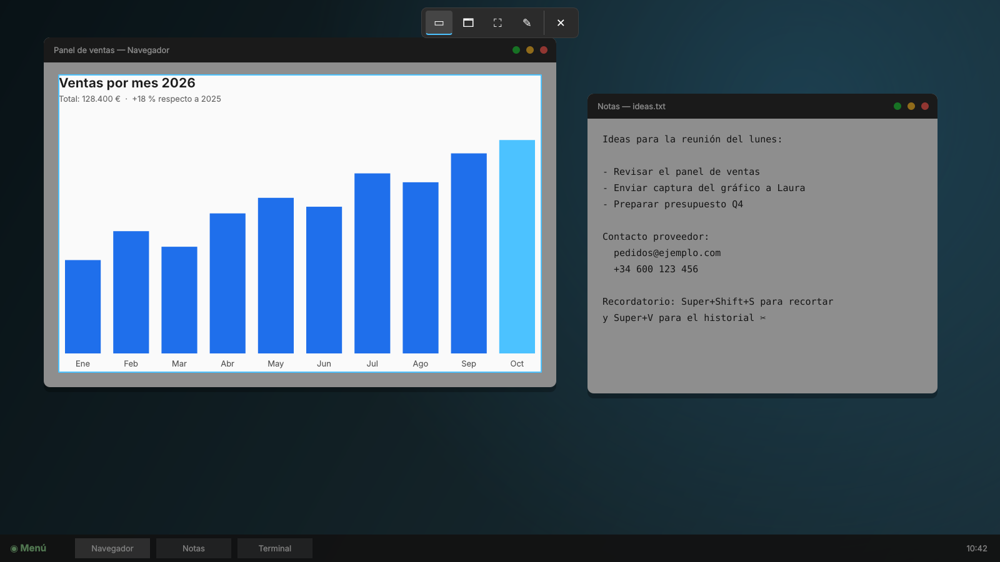
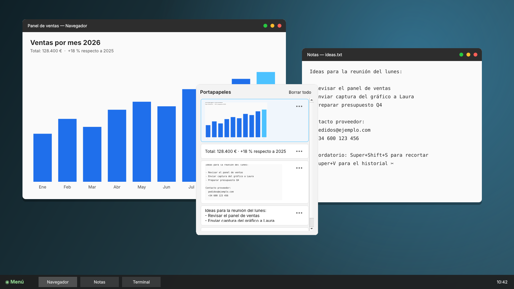
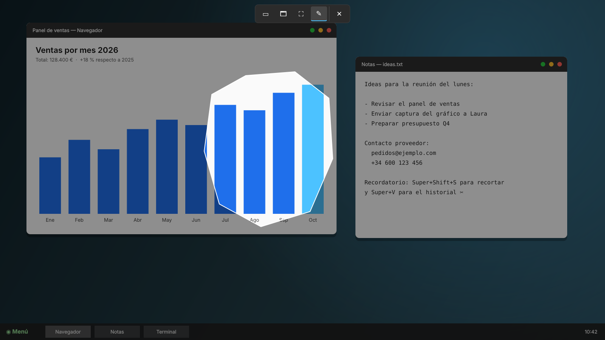

<div align="center">


# Cutter para Linux

**La Herramienta Recortes y el historial del portapapeles de Windows, para Linux.**

Pulsa <kbd>Super</kbd>+<kbd>Shift</kbd>+<kbd>S</kbd> para recortar cualquier parte de la pantalla
y <kbd>Super</kbd>+<kbd>V</kbd> para ver todo lo que has copiado.

Paquetes para Debian y derivadas (Ubuntu, Linux Mint, Pop!_OS, Zorin OS) y para Arch Linux y derivadas (CachyOS, EndeavourOS, Manjaro).<br />
Funciona en KDE Plasma, GNOME, Cinnamon, XFCE y Hyprland, en X11 y Wayland.

</div>



## ¿Qué es Cutter?

Si vienes de Windows, seguro que usas a diario la Herramienta Recortes y el historial
del portapapeles. Cutter lleva esa misma experiencia a Linux con los mismos atajos y
el mismo comportamiento. Se instala con un solo paquete `.deb` o con `pacman`.

| Atajo | Qué hace |
|---|---|
| **Super + Shift + S** | Congela la pantalla y te deja elegir qué recortar. El recorte se copia al portapapeles y se guarda en `Imágenes/Capturas de pantalla`. |
| **Super + V** | Abre el historial del portapapeles con todo lo que copiaste, tanto textos como imágenes. Al elegir un elemento se pega en la app que estabas usando. |

<table>
<tr>
<td width="50%"></td>
<td width="50%"></td>
</tr>
<tr>
<td align="center"><b>Super+V</b>: historial con textos e imágenes</td>
<td align="center">Recorte de <b>forma libre</b></td>
</tr>
</table>

## Instalación

### Debian, Ubuntu, Linux Mint, Pop!_OS, Zorin OS

```bash
wget https://github.com/anrennnn/Cutter-Linux/raw/main/instalador/cutter-linux_0.2.0_all.deb
sudo apt install ./cutter-linux_0.2.0_all.deb
```

Para desinstalarlo: `sudo apt remove cutter-linux`.

### Arch Linux, CachyOS, EndeavourOS, Manjaro

Con el paquete ya generado:

```bash
wget https://github.com/anrennnn/Cutter-Linux/raw/main/instalador/cutter-linux-0.2.0-1-any.pkg.tar.zst
sudo pacman -U cutter-linux-0.2.0-1-any.pkg.tar.zst
```

O compilándolo tú con el `PKGBUILD`, al estilo del AUR:

```bash
git clone https://github.com/anrennnn/Cutter-Linux.git
cd Cutter-Linux/packaging/arch
makepkg -si
```

Para desinstalarlo: `sudo pacman -R cutter-linux`.

### Después de instalar

Abre **Cutter** desde el menú de aplicaciones una vez, o cierra sesión y vuelve a
entrar. La primera vez que se abre, Cutter configura Super+Shift+S y Super+V en tu
escritorio.

En **KDE Plasma** (el escritorio por defecto de CachyOS), Spectacle y Klipper ya usan
esos atajos. Cutter le deja a Spectacle la tecla <kbd>Imprimir</kbd> y desactiva el
Meta+V de Klipper.

En **Hyprland, Sway o niri** los atajos van en tu archivo de configuración. Cutter
no lo modifica, pero te muestra las líneas que tienes que añadir.

## Funciones (Fase 1)

**Recorte (Super+Shift+S)**
- Cuatro modos, igual que en Windows: rectangular, ventana, pantalla completa y forma libre.
- Barra de modos arriba en el centro. Para cancelar, pulsa Esc, el botón ✕ o el clic derecho.
- Varios monitores: cada pantalla se oscurece y en cualquiera puedes seleccionar.
- El recorte va al portapapeles, se guarda como PNG y aparece una notificación. Si haces clic en ella, se abre la imagen.
- En el modo forma libre, lo que queda fuera de la forma es transparente.

**Portapapeles (Super+V)**
- Guarda hasta 25 elementos de texto e imagen. Los fijados no cuentan para ese límite y se mantienen aunque reinicies.
- En el menú `•••` de cada elemento puedes Fijar/Desanclar, Eliminar y Borrar todo.
- Se maneja con el teclado: ↑ ↓ para moverte, Enter para pegar, Supr para eliminar y Esc para cerrar.
- Se adapta al tema claro u oscuro del sistema.
- No guarda las contraseñas copiadas desde gestores como KeePassXC.

## Compatibilidad

| Escritorio | Atajos | Recorte | Historial |
|---|---|---|---|
| Cinnamon (Mint), X11 | ✅ automáticos | ✅ todos los modos | ✅ y pega solo |
| XFCE, X11 | ✅ automáticos | ✅ todos los modos | ✅ y pega solo |
| GNOME / Pop!_OS / Zorin, X11 | ✅ automáticos (las notificaciones pasan a Super+M) | ✅ todos los modos | ✅ y pega solo |
| GNOME, Wayland | ✅ automáticos | ✅ por el portal; sin modo ventana | ✅ vía XWayland (sin probar aún); copia pero no pega solo |
| KDE Plasma 6, Wayland (CachyOS) | ✅ automáticos (libera Spectacle y Klipper) | ✅ por el portal; sin modo ventana | ✅ con `wl-clipboard`; copia pero no pega solo |
| Hyprland / Sway / niri | ✍️ se añaden a mano (Cutter te dice qué líneas) | ✅ por el portal o `grim`; sin modo ventana | ✅ con `wl-clipboard`; copia pero no pega solo |

En Wayland las aplicaciones no pueden ver la pantalla ni las demás ventanas. Por eso
la captura se pide al portal del escritorio (la primera vez GNOME pregunta si das
permiso) y el modo ventana solo está disponible en X11.

En Arch y CachyOS conviene instalar también `wl-clipboard`, `xdg-desktop-portal` y
`qt6-wayland` si usas Wayland:
`sudo pacman -S --needed wl-clipboard xdg-desktop-portal qt6-wayland`.

## Comandos

```bash
cutter-linux recortar [--modo rect|window|full|free]
cutter-linux historial
cutter-linux atajos        # vuelve a configurar los atajos del escritorio
cutter-linux salir         # detiene el proceso de fondo
```

## Próximas fases

- **Fase 2:** editor del recorte con bolígrafo, resaltador, borrador, regla, recortar,
  deshacer, guardar como y copiar. También acciones de texto (OCR con Tesseract:
  copiar todo el texto, ocultar correos y teléfonos) y retraso de 3, 5 y 10 s.
- **Fase 3:** grabación de pantalla con audio, lector de códigos QR, emojis y símbolos
  en Super+V, y extensión de GNOME Shell para el portapapeles nativo en Wayland.

## Desarrollo

```bash
# Debian / Ubuntu / Mint
sudo apt install python3-pyqt6 xdotool x11-utils wl-clipboard
# Arch / CachyOS
sudo pacman -S --needed python-pyqt6 xdotool xorg-xprop xorg-xwininfo wl-clipboard

PYTHONPATH=src python3 -m cutter_linux recortar
./build-deb.sh                       # genera dist/cutter-linux_<versión>_all.deb
cd packaging/arch && makepkg         # genera cutter-linux-<versión>-1-any.pkg.tar.zst
sudo make install                    # instalación manual en /usr
```

Licencia MIT. No contiene código de Microsoft: replica el comportamiento de la herramienta
de Windows a partir de su funcionamiento público.
